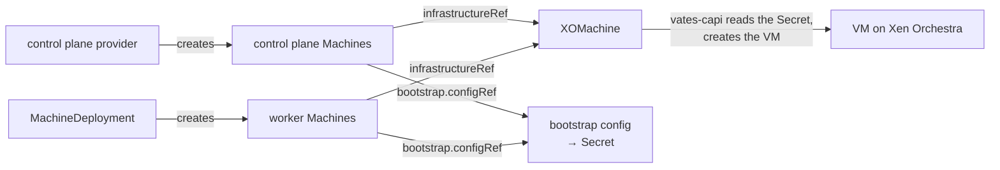
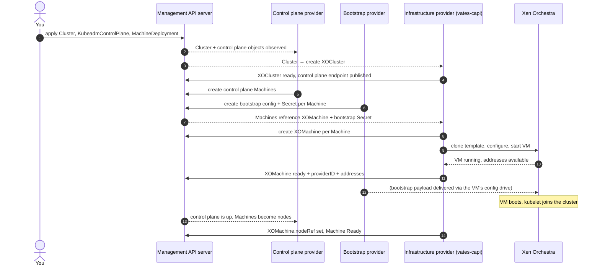

# How they fit together

The [previous page](providers.md) described the three providers as independent
roles. This page shows the machinery that connects them. The core idea, stated
once and then unpacked:

> Providers do not call each other. They communicate by creating Kubernetes
> objects that reference one another, and by watching those objects.

That is what makes the pieces loose and replaceable. Let's follow the references.

## A cluster is a small graph of references

When you apply a cluster, you create a handful of objects. Each of them points
at the next using a **reference** field. Read this table top to bottom and you
have the whole structure:

| Object (written by) | Reference field | Points to | Written by |
|---|---|---|---|
| `Cluster` *(you)* | `spec.infrastructureRef` | `XOCluster` | infrastructure provider |
| `Machine` *(you / control plane provider)* | `spec.infrastructureRef` | `XOMachine` | infrastructure provider |
| `Machine` | `spec.bootstrap.configRef` | `KubeadmConfig` / `TalosConfig` | bootstrap provider |
| `KubeadmControlPlane` *(control plane provider)* | `spec.infrastructureRef` | `XOMachineTemplate` | infrastructure provider |
| `MachineDeployment` *(you)* | `spec.infrastructureRef` / `spec.bootstrap.configRef` | `XOMachineTemplate` / `KubeadmConfigTemplate` | infra / bootstrap provider |

The `Machine` is the pivot. Two things create machines — the control plane
provider (for control plane nodes) and a `MachineDeployment` (for workers) — and
each `Machine` then points at the two things it needs: an infrastructure object
and a bootstrap config.

Two patterns are worth noticing:

- **The "Template" objects.** `XOMachineTemplate` and friends are *stencils*:
  control plane and worker groups stamp out many `XOMachine` objects from one
  template. You edit the template to change the shape of every future machine.
- **Bootstrap data travels in a Secret.** The bootstrap provider never hands the
  payload to the infrastructure provider directly. It writes it into a
  Kubernetes `Secret`; the infrastructure provider reads the `Secret` that the
  owning `Machine` points to. One more indirection, no coupling.

## Watching, not calling

Each provider runs a controller that **watches** the objects it cares about.
When something changes, it reconciles. Concretely:

- The infrastructure controller creates its `XOCluster` / `XOMachine` objects
  *from* the `Cluster` / `Machine` that reference them, and keeps their status
  up to date.
- The infrastructure controller also watches the bootstrap `Secret` referenced
  by each `Machine`, so it can deliver the payload as soon as it appears.
- The user or control plane provider writes `Machine` objects; nobody "asks" the
  infrastructure provider to do anything — it just notices.

Because everything is a watched object, the system is eventually consistent and
self-healing. If a controller restarts, it re-reads state and continues.

## End to end: what happens when you create a cluster

Step 11 is worth a pause: the bootstrap payload written at step 7 is what the VM
reads on its very first boot. The infrastructure provider is just the courier.

## Ownership and cleanup

References also define **ownership**. The control plane provider owns its
control plane `Machine`s; a `Machine` owns its `XOMachine`; a `Cluster` owns its
`XOCluster`. Kubernetes [owner references](https://kubernetes.io/docs/concepts/architecture/garbage-collection/#owners-and-dependents)
then do the rest: delete the `Cluster` and its dependents are garbage-collected
in the right order.

That is why deleting a cluster is a single `kubectl delete cluster`, and why the
provider implements finalizers to shut down and remove the underlying VMs before
letting the object go.

## Recap

- Providers **reference** each other through object fields; they never call each
  other.
- Bootstrap payloads travel through **Secrets**, addressed by the `Machine`.
- **Templates** produce many machines; **owner references** keep them tidy.
- Every provider simply **watches and reconciles** the objects it owns.

With that model in hand, [Where Vates CAPI fits](vates-provider.md) is easy: it is the
infrastructure provider in this graph, and nothing more.
