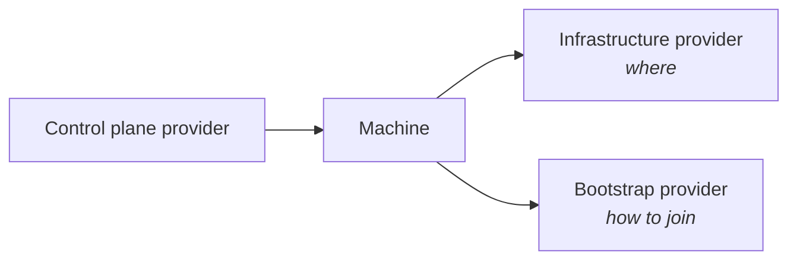

# The three providers

A working Cluster API setup needs three kinds of provider, each with a narrow and
well-defined job. Understanding the split is the single most useful thing you can
learn about Cluster API, because it explains almost every design decision you
will meet later.

## 1. Infrastructure provider — *where the node runs*

An **infrastructure provider** turns a generic `Machine` into an actual machine
somewhere. It knows how to talk to a specific platform — a cloud, a hypervisor,
a bare-metal API — and it owns the custom resources that represent that
platform's machines and clusters.

**vates-capi is an infrastructure provider for Xen Orchestra / XCP-ng.** It
clones a VM template, configures the VM, starts it, attaches it to the right
networks, and reports the VM's addresses back. It does not know or care whether
the VM will run kubeadm or Talos.

Examples: `cluster-api-provider-vates` (this project), CAPA for AWS, CAPV for
vSphere, etc.

## 2. Bootstrap provider — *how the node joins the cluster*

A **bootstrap provider** produces the data a machine needs to *boot into* the
cluster. It generates the initial configuration — a cloud-init script, an
ignition config, an OpenShift machine config, a Talos machine config… — and
hands it over so the infrastructure provider can deliver it to the VM.

It is the bootstrap provider that knows things like the join token, the
certificate authority, and the kubelet settings.

Examples: `kubeadm` (the reference bootstrap provider), `Talos`, `vates`
(experimental, this project), `k0smotron`, `openshift`.

## 3. Control plane provider — *who runs the control plane*

A **control plane provider** owns the control plane Machines: how many there
are, how they scale up and down, rolling upgrades, and the API server endpoint
that the rest of the cluster talks to.

For a self-managed cluster, the control plane is itself a set of VMs managed by
a `MachineDeployment`-like controller. That controller is the control plane
provider.

Examples: `kubeadm` (KCP, the reference control plane provider), `Talos`,
`vates` (experimental, this project), `k0smotron`.

## Why split it this way?

The split keeps each provider small and replaceable:

- The **infrastructure** provider only speaks its platform's language. Adding a
  new bootstrap mechanism never means changing it.
- The **bootstrap** provider only knows how to prepare a node. It works on any
  infrastructure, from AWS to XCP-ng.
- The **control plane** provider only orchestrates control plane nodes. It works
  with any bootstrap and any infrastructure too.

Because the three roles are independent, they compose. The same kubeadm
bootstrap provider serves clusters on AWS, vSphere, and Xen Orchestra. The
vates-capi provider serves any bootstrap provider that can emit a payload it can
deliver.

!!! tip "The combinations you will actually see here"

    With vates-capi you can mix and match:

    - **kubeadm** bootstrap + **kubeadm** control plane → the classic
      cloud-init flow: it works with any cloud-init-capable OS, but it *needs*
      cloud-init ([guide](../guides/providers/kubeadm.md)).
    - **Vates Kube OS** bootstrap + **Vates Kube OS** control plane → the
      immutable node image, **experimental**
      ([guide](../guides/providers/vates-kube-os.md)).
    - **Talos** bootstrap + **Talos** control plane → an immutable,
      cloud-init-free OS ([guide](../guides/providers/talos/index.md)).

    The infrastructure provider is the same in all cases. That is the payoff of
    the split.

!!! info "One provider package can fill several roles"

    Nothing stops a single project from shipping more than one kind of provider.
    The kubeadm project provides both a bootstrap *and* a control plane
    provider. vates-capi provides only the infrastructure role — it relies on
    others for the rest.
