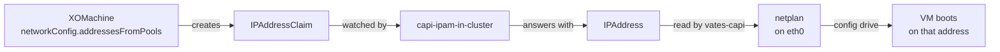

# IPAM

By default a node gets its address from whatever answers on the network —
DHCP, or a static address you write by hand into `networkConfig.guestConfig`.
For a control plane node that is fragile: its identity is tied to its address
(etcd records the peer URL it joined with), and a lease that moves is a control
plane that can be lost on the next reboot.

**Cluster API has an IPAM contract for exactly this.** The infrastructure
provider asks a *pool* for an address, and the pool answers with one the provider
then writes into the node's network configuration before first boot. vates-capi
implements the infrastructure side; this page shows how to install an IPAM
provider and use it.

We use **[capi-ipam-in-cluster](https://github.com/kubernetes-sigs/cluster-api-ipam-provider-in-cluster)**,
the reference in-cluster implementation: the pools are ordinary Kubernetes
objects, so there is nothing else to run and the addresses live with the cluster
that consumes them.

## The pieces



Three objects are involved, and only the first and the last are yours:

| Object | Group / version | Written by | Scope |
|---|---|---|---|
| `InClusterIPPool` | `ipam.cluster.x-k8s.io/v1alpha2` | **you** | Namespaced |
| `GlobalInClusterIPPool` | `ipam.cluster.x-k8s.io/v1alpha2` | **you** | Cluster |
| `InClusterPrefixPool` / `GlobalInClusterPrefixPool` | `ipam.cluster.x-k8s.io/v1alpha2` | **you** | Namespaced / Cluster |
| `IPAddressClaim` | `ipam.cluster.x-k8s.io/v1beta2` | vates-capi | Namespaced |
| `IPAddress` | `ipam.cluster.x-k8s.io/v1beta2` | the IPAM provider | Namespaced |

The four pool kinds come from the in-cluster provider. The `IPAddressClaim` and
`IPAddress` objects are part of Cluster API itself: they are installed with CAPI
core, not with the IPAM provider.

!!! note "Address pools versus prefix pools"

    For node addresses you want an **address pool** (`InClusterIPPool` or
    `GlobalInClusterIPPool`). vates-capi renders the returned address and prefix
    as a static host address, so that is the kind it expects. The
    `…PrefixPool` kinds allocate a whole IPv6 prefix per claim instead, and are
    not meant for this.

## Prerequisites

- A management cluster with Cluster API running (see
  [Installation](../getting-started/installation.md)).
- `clusterctl` on your workstation.
- A pool of free addresses on **the same network you attach the VMs to** (the
  `networkConfig.networks`) and routed to reach the management cluster.
- **No overlap** with the control plane VIP (see [VIP](vip.md)) nor with
  anything else handing out addresses on that network, DHCP included.

## Install the IPAM provider

With `clusterctl`, the provider is named **`in-cluster`** and installed in one
flag:

```bash
clusterctl init --ipam in-cluster
```

If you are still installing the rest of the stack, do it in the same command:

```bash
clusterctl init \
  --bootstrap kubeadm --control-plane kubeadm \
  --infrastructure vates:v1.1.0-rc4 \
  --ipam in-cluster
```

!!! warning "Install it before the Cluster"

    The IPAM provider **and its CRDs** must exist before any cluster that uses a
    pool is created. vates-capi creates `IPAddressClaim` objects while
    reconciling `XOMachine`s; if the IPAM CRDs are not installed yet, it has
    nothing to create them against. Retrofitting IPAM onto a running cluster is
    possible, but you must add `addressesFromPools` and let the machines be
    recreated.

`clusterctl init` also makes sure cert-manager is present, which the provider's
validating webhook needs.

Check that both halves landed — the provider's pools and CAPI's claim/address
types:

```bash
kubectl get crds | grep ipam.cluster.x-k8s.io

kubectl -n capi-ipam-in-cluster-system get deployment
```

You should see `inclusterippools`, `globalinclusterippools` (and the two prefix
pools), plus `ipaddressclaims` and `ipaddresses`.

## Define a pool

A pool is a range of addresses, a prefix, and a gateway. Give each cluster its
own pool, named after it, in the cluster's namespace:

```yaml
apiVersion: ipam.cluster.x-k8s.io/v1alpha2
kind: InClusterIPPool
metadata:
  name: my-cluster-pool
  namespace: default
spec:
  addresses:
    - 10.30.139.200-10.30.139.220
  gateway: 10.30.0.1
  prefix: 16
```

- `addresses` accepts CIDR blocks, ranges (`first-last`), and single addresses.
- `gateway` is never handed out, and is used by the node as its default route
  and resolver (see [Gotchas](#gotchas)).
- `prefix` is the network prefix length the node is configured with.
- By default the first (network) and last (broadcast) address of an IPv4 prefix
  are reserved and not allocated. Set `allocateReservedIPAddresses: true` to use
  them anyway — the gateway is still excluded.

!!! tip "Use a `GlobalInClusterIPPool` to share across namespaces"

    An `InClusterIPPool` is namespaced, and the reference below has **no
    namespace field** — the pool is always resolved in the namespace of the
    machine that claims it. If machines live in several namespaces and should
    draw from one pool, use `GlobalInClusterIPPool`, which is cluster-scoped.

## Reference the pool from a machine template

Add an `addressesFromPools` entry to the `networkConfig` of the
`XOMachineTemplate` used by the control plane and by the workers. Keep the
matching `networks` so the VM is attached to the right XO network:

```yaml
apiVersion: vates.infrastructure.cluster.x-k8s.io/v1beta2
kind: XOMachineTemplate
metadata:
  name: my-cluster-cp
  namespace: default
spec:
  template:
    spec:
      namePrefix: my-cluster-cp
      templateID: <your-vm-template-uuid>
      poolID: <your-xo-pool-uuid>
      networkConfig:
        addressesFromPools:
          - apiGroup: ipam.cluster.x-k8s.io
            kind: InClusterIPPool
            name: my-cluster-pool
        networks:
          - networkID: <your-xo-network-uuid>
```

Each entry is an
[`IPPoolReference`](https://cluster-api.sigs.k8s.io/reference/api/ipam/v1beta2) —
`apiGroup`, `kind`, `name`, and nothing else. Repeat the same block in every
machine template, control plane and worker alike, so a replacement node comes
back on a stable address.

A complete, copy-pasteable pool plus machine template:

```yaml
apiVersion: ipam.cluster.x-k8s.io/v1alpha2
kind: InClusterIPPool
metadata:
  name: my-cluster-pool
  namespace: default
spec:
  addresses:
    - 10.30.139.200-10.30.139.220
  gateway: 10.30.0.1
  prefix: 16
---
apiVersion: vates.infrastructure.cluster.x-k8s.io/v1beta2
kind: XOMachineTemplate
metadata:
  name: my-cluster-cp
  namespace: default
spec:
  template:
    spec:
      namePrefix: my-cluster-cp
      templateID: <your-vm-template-uuid>
      poolID: <your-xo-pool-uuid>
      resourceSet:
        cpus: 2
        memory: 4Gi
        diskSize: 20Gi
      networkConfig:
        addressesFromPools:
          - apiGroup: ipam.cluster.x-k8s.io
            kind: InClusterIPPool
            name: my-cluster-pool
        networks:
          - networkID: <your-xo-network-uuid>
```

## What vates-capi does with the address

When a `XOMachine` has a non-empty `addressesFromPools`, the controller takes
over the machine's addressing. Precisely:

1. It creates an `IPAddressClaim` named **after the `XOMachine`**, in the same
   namespace, owned by the `XOMachine`. `spec.poolRef` is the **first** entry of
   `addressesFromPools`, and `spec.clusterName` is the machine's
   `cluster.x-k8s.io/cluster-name` label.
2. Until the IPAM provider sets the claim's `status.addressRef`, there is no
   address, so the controller **does not create the VM**. It sets a
   `WaitingForAddress` condition and requeues every 5 seconds. The address is
   never guessed in the meantime.
3. Once the claim is answered, the controller reads the referenced `IPAddress`
   and takes its `spec.address`, `spec.prefix`, and `spec.gateway`.
4. It renders a netplan v2 document for the `eth0` interface — static address,
   `dhcp4: false`, and (when a gateway is set) a default route and resolver:

    ```yaml
    version: 2
    ethernets:
      eth0:
        dhcp4: false
        addresses:
          - 10.30.139.200/16
        routes:
          - to: default
            via: 10.30.0.1
        nameservers:
          addresses:
            - 10.30.0.1
    ```

5. That document **replaces** the machine's own networking (the bootstrap
   provider's network config and `networkConfig.guestConfig`) and is delivered
   through the VM's config drive. The node comes up on the address the pool
   chose.
6. The VIFs still come from `networkConfig.networks`; the pool only decides the
   *address*, not which XO network the VM is plugged into.
7. Deleting the `XOMachine` (or the `Machine` that owns it) deletes the
   `IPAddressClaim` through its owner reference, which releases the address back
   to the pool.

The address vates-capi reports in `XOMachine.status.addresses` is still read back
from Xen Orchestra's guest tools, as for any other machine — the netplan is what
makes the guest actually use the claimed address.

## Verify

Watch the claim be created and answered:

```bash
kubectl get ipaddressclaims -n default
kubectl get ipaddresses -n default

kubectl get inclusterippool my-cluster-pool -n default -o yaml
```

The pool's `status` shows how many addresses it has allocated and how many are
still free. On the machine side, the address appears in the usual place once the
node has booted:

```bash
kubectl get xomachines -n default -o wide
kubectl get xomachine <machine-name> -n default \
  -o jsonpath='{.status.addresses}'
```

If a machine sits without an address, look at its conditions — a
`WaitingForAddress` reason means the claim exists but the pool has not answered
it yet.

## Gotchas

**The pool must exist before the machines do.** If no pool matches the reference,
the claim stays unanswered forever and every machine waits. Create the pool in
the same manifest (or apply it first) before the `Cluster` that uses it.

**One pool per cluster.** Because the reference carries no namespace, a
namespaced pool is shared by every machine that names it in that namespace. Two
clusters in the same namespace that point at the same pool will compete for the
same addresses. Name the pool after the cluster, as above.

**Do not overlap the control plane VIP.** The VIP (kube-vip) is a fixed address
on the same network. If the pool contains it, the pool will eventually hand it to
a node and the API endpoint will fight that node for it. Carve the range so it
stops well short of the VIP.

**`addressesFromPools` wins over `guestConfig`.** When both are set, the address
from the pool replaces the static configuration in `guestConfig`. Do not expect
`guestConfig` to win.

**Only the first pool is used.** The controller reads
`addressesFromPools[0]`. Listing several pools does not load-balance or fall
back; put the one pool you mean first.

**The gateway is also the resolver.** An IPAM `IPAddress` carries no DNS servers,
so the rendered netplan uses the pool's gateway as both the default route and the
nameserver. If your network resolves through a different server, this is wrong
for you — there is no field to set it today.

**The interface is `eth0`.** The rendered document names `eth0`, which is the
interface the node image brings up first. This is not configurable.

**Prefix pools are not address pools.** An IP address allocation is what the
infrastructure provider renders into a host address; a prefix allocation is a
whole subnet. Use `InClusterIPPool` / `GlobalInClusterIPPool`.

## Where next

- Attaching the VM to networks, and `guestConfig` without IPAM:
  [Networking](networking.md).
- The floating control plane endpoint the pool must not overlap:
  [VIP](vip.md).
- The `networkConfig` fields on the API:
  [XOMachineTemplate](../reference/crds/xomachinetemplate.md).
