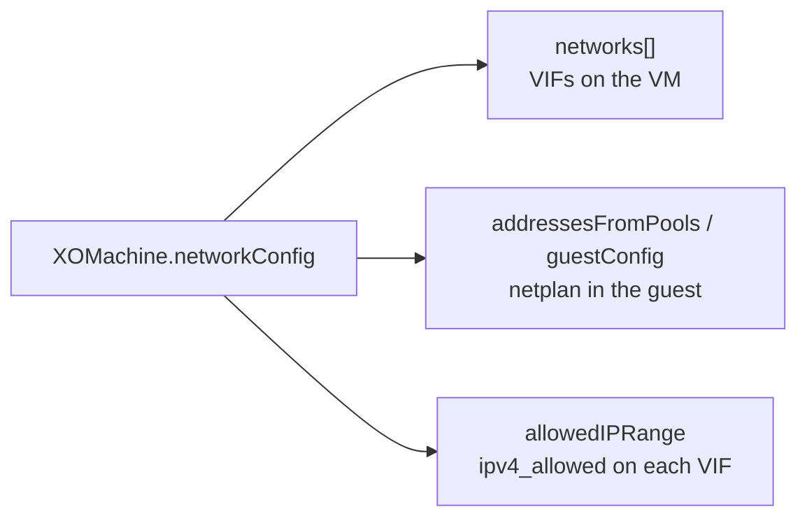

# Networking

How a VM's virtual interfaces are attached, addressed, and filtered.

A `XOMachine` describes its networking in a single `networkConfig` block. Three
things live there, and it is worth keeping them apart:

| Field | Decides |
|---|---|
| `networks` | **Which** Xen Orchestra networks the VM is plugged into. |
| `addressesFromPools` / `guestConfig` | **Which address** the guest uses (via [IPAM](ipam.md) or a static netplan). |
| `allowedIPRange` | **Who may talk to** the VM at the hypervisor level. |

They are independent. `networks` is the wiring; the address and the filter are
policy applied on top of it. A machine with no `networkConfig` at all still boots
— it simply takes whatever the XO template already had and gets its address from
DHCP.



## Attaching networks

`networkConfig.networks` is a list. Each entry names one Xen Orchestra network,
either by UUID or by name:

```yaml
apiVersion: vates.infrastructure.cluster.x-k8s.io/v1beta2
kind: XOMachineTemplate
metadata:
  name: my-cluster-cp
  namespace: default
spec:
  template:
    spec:
      namePrefix: my-cluster-cp
      templateID: <your-vm-template-uuid>
      poolID: <your-xo-pool-uuid>
      networkConfig:
        networks:
          - networkID: <your-xo-network-uuid>
```

| Field | Meaning | How it is resolved |
|---|---|---|
| `networkID` | The network's XO UUID. | Used as-is; **no API call**. |
| `name` | The network's XO name label. | Looked up through the XO V1 API. |

Prefer `networkID`. It is direct, needs no lookup, and cannot be ambiguous. Use
`name` only when you do not have the UUID — and know the trade-off: XO does not
enforce uniqueness on network names, so a name can match the wrong network. When
the machine also has a `poolID`/`poolName`, the lookup is narrowed to that pool,
but it is still a name match.

!!! tip "Where to find the values"

    In Xen Orchestra, open the network's page for its UUID, and the pool's page
    for the pool UUID. The [Prerequisites](../getting-started/prerequisites.md)
    table lists every identifier the provider needs.

### Interface ordering

The **order of the list is the order of the interfaces**. The first entry becomes
VIF device `0`, the second device `1`, and so on, which surfaces in the guest as
`eth0`, `eth1`, … Put the network that carries the node's address (and reaches the
API server) **first**.

```yaml
      networkConfig:
        networks:
          - networkID: <primary-network-uuid>   # device 0 → eth0
          - name: "Storage VLAN 60"             # device 1 → eth1
```

The address the provider renders — from [IPAM](ipam.md) or from `guestConfig` —
always targets `eth0`, so a machine whose first network is not the routable one
will come up with an address on the wrong wire.

!!! warning "The VIF list is fixed at creation"

    Networks are attached in the same XO call that creates the VM. Adding an
    entry to `networks` on an existing `XOMachine` does **not** attach it: the
    reconciler only reconnects VIFs that are already there, it never adds one.
    To change a machine's wiring, replace the machine — roll its
    `MachineDeployment` or the control plane — so a new VM is created.

## Addressing the guest

There are three ways a node gets its address, and they are mutually exclusive in
practice.

### DHCP (the default)

Leave both `guestConfig` and `addressesFromPools` empty. The guest runs whatever
its OS does by default — usually DHCP — and the provider does not configure an
address at all. It reads back what Xen Orchestra's guest tools report into
`status.addresses`. This is fine for workers; it is fragile for a control plane
node, whose identity is tied to its address.

### A static address with `guestConfig`

`networkConfig.guestConfig` is a cloud-init **netplan v2** document, passed
through to the guest before first boot. Use it to pin an address, a route, or a
resolver the guest would not get from DHCP:

```yaml
      networkConfig:
        guestConfig: |
          version: 2
          ethernets:
            eth0:
              dhcp4: false
              addresses:
                - 10.30.139.10/16
              routes:
                - to: default
                  via: 10.30.0.1
              nameservers:
                addresses:
                  - 10.30.0.1
        networks:
          - networkID: <your-xo-network-uuid>
```

The document is delivered as-is through the VM's config drive; the provider does
not parse or validate it. It still needs `networks` to attach the interface the
document configures.

### A claimed address with `addressesFromPools`

This is the [IPAM](ipam.md) path. Instead of writing an address yourself, you
name a pool and let an IPAM provider hand one out:

```yaml
      networkConfig:
        addressesFromPools:
          - apiGroup: ipam.cluster.x-k8s.io
            kind: InClusterIPPool
            name: my-cluster-pool
        networks:
          - networkID: <your-xo-network-uuid>
```

The provider creates an `IPAddressClaim`, waits for the IPAM provider to answer,
then renders the returned address as a static netplan document — exactly like
`guestConfig`, but with an address the pool chose. This is what keeps a control
plane node's address stable across a reboot.

!!! warning "`addressesFromPools` replaces `guestConfig`"

    When both are set, the claimed address wins: the provider overwrites the
    machine's network configuration with the netplan it renders from the pool.
    Do not expect `guestConfig` to take effect. See
    [IPAM → Gotchas](ipam.md#gotchas) for the rest of the rules.

## Filtering with `allowedIPRange`

`networkConfig.allowedIPRange` is a CIDR of addresses allowed to reach the VM.
The provider applies it to **every** VIF of the machine, through the XO
`vif.set` call's `ipv4_allowed` field:

```yaml
      networkConfig:
        allowedIPRange: 10.30.139.0/24
        networks:
          - networkID: <your-xo-network-uuid>
```

When it is empty, no restriction is set. Note that this is a hypervisor-level
filter, applied **after** the VM is up, on each reconcile — not at creation. If
the XO version in front of you does not support `ipv4_allowed`, the call fails,
the provider logs it and carries on: the VM is left unrestricted rather than
blocked.

## Common pitfalls

**A network is not found, and the interface is silently missing.** If a `name`
lookup fails, or an entry has neither `networkID` nor `name`, the provider logs
the error and **skips that entry** — it does not fail the machine. The VM is
created with fewer interfaces than you asked for. Check the controller logs for
`Failed to resolve network for VM creation`, and prefer `networkID` to remove the
lookup entirely.

**No address is ever reported.** `status.addresses` comes from Xen Orchestra's
guest tools, not from the provider. If the guest agent is not installed or not
running in the template, the machine sits with a `WaitingForIPAddress` condition
and requeues forever. This is a template problem, not a networking one — see
[Prerequisites](../getting-started/prerequisites.md). Built-in link-local
addresses (`169.254.0.0/16`, `fe80::/10`) are deliberately ignored.

**A claim exists but no address arrives.** With `addressesFromPools`, a
`WaitingForAddress` condition means the pool has not answered the `IPAddressClaim`
yet. The machine waits — it does not fall back to DHCP. Check the claim and the
pool, as described in [IPAM → Verify](ipam.md#verify).

**The node's address is on the wrong interface.** The rendered netplan always
names `eth0`; make sure the address-bearing network is the first entry in
`networks`.

## Where next

- The full IPAM story, from pool to node: [IPAM](ipam.md).
- The floating control plane endpoint that must not overlap the pool:
  [VIP](vip.md).
- Every `networkConfig` field on the API:
  [XOMachine → networkConfig](../reference/crds/xomachine.md#networkconfig).
